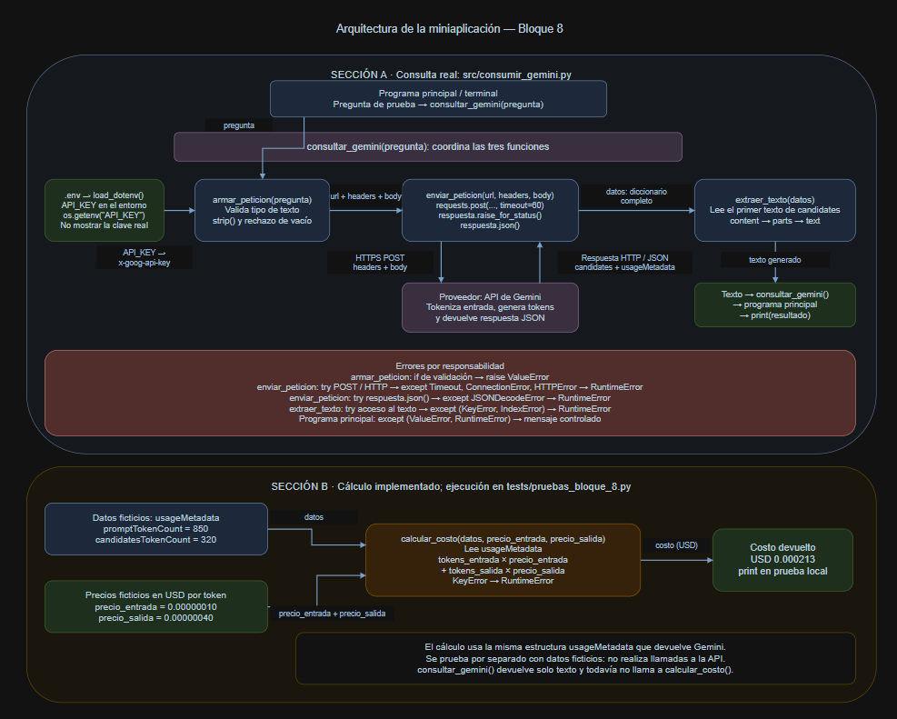

# Decisión de arquitectura: elección de modelo

Estado: modelo seleccionado para el prototipo y configurado
como predeterminado en el código.

## Contexto del proyecto

La aplicación busca interpretar la necesidad descrita por una persona
e identificar qué tipo de trabajador necesita para atenderla.

Inicialmente se compararon Gemini 3.8 Flash y Gemini 3.5 Flash-Lite.
Debido a los errores HTTP 503 y timeouts observados con Gemini 3.8
Flash, se incorporó Gemini 3.6 Flash como candidato alternativo.

La comparación final considera Gemini 3.6 Flash y Gemini 3.5 Flash-Lite
según costo, tiempo de respuesta y calidad para este caso de uso.
Los resultados de Gemini 3.8 Flash se conservan como antecedentes.

## Modelo elegido

Se elige Gemini 3.5 Flash-Lite (`gemini-3.5-flash-lite`) para continuar
el desarrollo del prototipo.

En las pruebas realizadas identificó correctamente los oficios en
los dos casos claros, presentó menores tarifas por token y tuvo
menor latencia promedio entre las respuestas exitosas observadas.

La elección tiene una limitación: su respuesta ante una necesidad
ambigua requiere mejoras. Debe solicitar información adicional
antes de recomendar un oficio y responder de forma más breve.

Esta decisión no significa que el modelo cumpla todos los criterios
de calidad ni que esté validado para producción.

El módulo `src/consumir_gemini.py` utiliza ahora
`gemini-3.5-flash-lite` como modelo predeterminado en
`armar_peticion`. La función permite indicar otro modelo
explícitamente para realizar comparaciones.

Después del cambio, la comprobación de sintaxis y las pruebas
locales de los bloques 7 y 8 finalizaron correctamente.
Estas pruebas no realizan llamadas a la API.

## Diagrama de arquitectura

El siguiente diagrama corresponde a la implementación del bloque 8,
que se utiliza como base para comparar los modelos.

Se conserva como referencia de la arquitectura existente.
Si contiene el nombre del modelo anterior, ese rótulo representa
la configuración del bloque 8, no la elección realizada aquí.

## Comparación de candidatos

Fecha de consulta de precios: 22 de octubre de 2026.

Tarifas Standard del nivel de pago de Gemini API, expresadas en USD.

Precio por 1.000 tokens = precio por 1.000.000 de tokens / 1.000.

| Criterio | Gemini 3.6 Flash | Gemini 3.5 Flash-Lite |
|---|---|---|
| Identificador | gemini-3.6-flash | gemini-3.5-flash-lite |
| Precio por 1.000 tokens de entrada (USD) | 0.00075 | 0.00030 |
| Precio por 1.000 tokens de salida (USD) | 0.00375 | 0.00250 |
| Latencia promedio de la consulta del lavaplatos | Aproximadamente 6.54 s, calculados con tres respuestas exitosas de cuatro intentos | 2.11 s, promedio de cuatro respuestas exitosas |
| Calidad para nuestra aplicación | Identifica los oficios en los casos claros. En humedad presenta alternativas, pero incluye afirmaciones de gratuidad sin respaldo. Respuestas extensas. | Identifica los oficios en los casos claros. En humedad presenta alternativas, pero prioriza una causa sin información suficiente. Respuestas extensas. |

Fuente: [Precios oficiales de Gemini API](https://ai.google.dev/gemini-api/docs/pricing).

### Notas sobre los precios

- Las tarifas de salida incluyen los tokens de razonamiento.
- Las tarifas indicadas para Gemini 3.6 Flash están vigentes hasta
  el 31 de diciembre de 2026. Desde el 1 de enero de 2027 se anuncian
  USD 0.00150 de entrada y USD 0.00750 de salida por 1.000 tokens.
- Ambos modelos ofrecen un nivel gratuito sujeto a límites.
  La tabla utiliza tarifas de pago como referencia.
- El costo de una consulta depende de los tokens consumidos.
  Esta comparación de tarifas no representa un gasto real medido
  durante las pruebas.

## Consultas y criterios de evaluación

Se utilizaron las mismas consultas en los modelos evaluados.

| Caso | Consulta | Respuesta esperada |
|---|---|---|
| Necesidad clara | La llave del lavaplatos gotea incluso cuando la cierro. ¿Qué tipo de trabajador necesito? | Identifica a un gasfíter y explica brevemente por qué. |
| Otro oficio | Necesito fabricar e instalar un mueble de madera a medida para mi dormitorio. ¿Qué tipo de trabajador necesito? | Identifica a un carpintero o mueblista. |
| Necesidad ambigua | Hay una mancha de humedad en la pared del dormitorio y no sé de dónde viene. ¿Qué tipo de trabajador necesito? | Reconoce que falta información y hace preguntas para orientar la elección, sin asegurar una causa. |

Se evalúa si las respuestas:

- Identifican un oficio adecuado cuando la necesidad es clara.
- Son claras y breves.
- Solicitan información adicional cuando la necesidad es ambigua.
- Evitan inventar nombres de trabajadores, certificaciones
  o disponibilidad.

Se aceptan términos equivalentes para un mismo oficio, como
gasfíter, plomero y fontanero.

También se registran afirmaciones adicionales sin respaldo,
como asegurar que un servicio será gratuito sin conocer
las condiciones del proveedor o de una póliza.

### Método de medición de latencia

Se realizaron cuatro intentos de la primera consulta por modelo.

El tiempo se midió desde el envío de la petición hasta que
`enviar_peticion` devolvió la respuesta convertida desde JSON.
Incluye la comunicación con el servicio y el procesamiento
de la respuesta; no es una medida aislada del tiempo del modelo.

El script imprime el promedio cuando obtiene cuatro respuestas
exitosas. Esto ocurrió con Gemini 3.5 Flash-Lite.

Para Gemini 3.6 Flash se obtuvieron tres respuestas exitosas y
un error HTTP 503. Aunque el script informó una medición incompleta
respecto de los cuatro éxitos previstos, se calculó manualmente
un promedio descriptivo de los tres tiempos disponibles:

(7.06 + 6.89 + 5.68) / 3 = aproximadamente 6.54 segundos.

Este valor se calculó con los tiempos redondeados mostrados en
la terminal. No fue un promedio emitido por el script.

Los fallos se registran por separado y no se consideran respuestas
de duración cero. Por ello, los promedios describen únicamente
las respuestas exitosas y deben leerse junto con las incidencias.

Las consultas del mueble y de la humedad se utilizaron para evaluar
la calidad y no se incluyen en ese promedio.

La muestra es pequeña, tiene distinto número de respuestas exitosas
por modelo y se obtuvo en momentos diferentes. Los resultados no
garantizan el mismo rendimiento en otras condiciones.

## Resultados observados

### Gemini 3.5 Flash-Lite

Completó las seis peticiones de su ejecución.

Tiempos de las cuatro repeticiones de la primera consulta:

| Intento | Resultado | Tiempo |
|---|---|---|
| 1 | Exitoso | 2.22 s |
| 2 | Exitoso | 2.39 s |
| 3 | Exitoso | 1.57 s |
| 4 | Exitoso | 2.26 s |

Latencia promedio informada por el script: 2.11 segundos.

Evaluación de calidad:

- Lavaplatos: identificó correctamente a un plomero o fontanero,
  equivalente a gasfíter. Agregó recomendaciones de reparación
  que excedían la identificación del oficio.
- Mueble: identificó correctamente a un carpintero y mencionó
  al ebanista como alternativa especializada. Tiempo: 3.46 segundos.
- Humedad: reconoció diferentes causas posibles, pero priorizó
  una fuga de tuberías sin información suficiente del caso.
  No pidió aclaraciones antes de recomendar un profesional.
  Tiempo: 3.38 segundos.
- Las respuestas fueron más extensas de lo esperado.
- No se observaron nombres inventados de trabajadores,
  certificaciones ni disponibilidad.

Cumple la identificación del oficio en los casos claros.
El caso ambiguo cumple parcialmente los criterios definidos.

### Gemini 3.6 Flash

En la ejecución inicial completó cuatro de seis peticiones.
Posteriormente se repitió únicamente la consulta del mueble,
que había fallado, y se obtuvo una respuesta exitosa.

Tiempos de la primera consulta:

| Intento | Resultado | Tiempo de respuesta exitosa |
|---|---|---|
| 1 | Error HTTP 503 | No disponible |
| 2 | Exitoso | 7.06 s |
| 3 | Exitoso | 6.89 s |
| 4 | Exitoso | 5.68 s |

Promedio descriptivo de los tres tiempos exitosos:
aproximadamente 6.54 segundos.

Evaluación de calidad:

- Lavaplatos: identificó correctamente a un plomero, fontanero
  o gasfíter. Agregó posibles causas y consejos de reparación.
- Mueble: en la repetición individual identificó correctamente
  a un carpintero o ebanista. Explicó sus diferencias y agregó
  recomendaciones de contratación. Tiempo: 9.27 segundos.
- Humedad: reconoció que la elección depende del origen y presentó
  distintos oficios posibles. Sin embargo, afirmó que el seguro
  enviaría un profesional gratuitamente sin conocer la póliza.
  También mencionó diagnósticos gratuitos sin verificar proveedores.
  No pidió aclaraciones antes de orientar la elección.
  Tiempo: 11.91 segundos.
- Las respuestas fueron más extensas de lo esperado.
- No se observaron nombres concretos inventados de trabajadores
  ni certificaciones, pero sí afirmaciones de gratuidad sin respaldo.

Cumple la identificación del oficio en los casos claros.
El caso ambiguo cumple parcialmente los criterios definidos.

## Incidencias durante las pruebas

### Candidatos de la comparación final

| Modelo y ejecución | Peticiones exitosas | Errores HTTP 503 | Timeouts |
|---|---|---|---|
| Gemini 3.5 Flash-Lite: ejecución completa | 6 de 6 | 0 | 0 |
| Gemini 3.6 Flash: ejecución inicial | 4 de 6 | 2 | 0 |
| Gemini 3.6 Flash: repetición individual del mueble | 1 de 1 | 0 | 0 |
| Gemini 3.6 Flash: total | 5 de 7 | 2 | 0 |

Los errores locales de sintaxis o sangría no se cuentan como
peticiones a la API, porque impidieron iniciar el programa.

### Antecedente: Gemini 3.8 Flash

Se realizaron tres ejecuciones, con un total de 18 peticiones:

| Ejecución | Peticiones exitosas | Errores HTTP 503 | Timeouts |
|---|---|---|---|
| Primera | 0 de 6 | 5 | 1 |
| Segunda | 1 de 6 | 2 | 3 |
| Tercera | 0 de 6 | 5 | 1 |
| Total | 1 de 18 | 12 | 5 |

La única respuesta exitosa correspondió al lavaplatos:
identificó correctamente al gasfíter y tardó 53.43 segundos.

Ese tiempo es una medición individual, no un promedio.
No se obtuvieron respuestas exitosas para el mueble ni la humedad,
por lo que no se completó la evaluación de calidad de este modelo.

Se incorporó Gemini 3.6 Flash para continuar la comparación.
Los fallos registrados no permiten afirmar que la indisponibilidad
de Gemini 3.8 Flash sea permanente.

## Justificación

Se prioriza identificar correctamente el oficio y reconocer cuándo
la descripción no permite recomendarlo con suficiente fundamento.
También se consideran la claridad, el costo y el tiempo de respuesta.

Ambos candidatos identificaron los oficios en los casos claros,
pero ninguno cumplió completamente el criterio de pedir información
adicional ante la humedad. Por tanto, no se considera resuelto
el manejo de necesidades ambiguas.

Para continuar el prototipo se elige Gemini 3.5 Flash-Lite porque:

- Identificó correctamente los oficios en los dos casos claros.
- Sus tarifas de entrada y salida por token son menores.
- Su promedio observado fue de 2.11 segundos, frente a
  aproximadamente 6.54 segundos de Gemini 3.6 Flash.
- Completó las seis peticiones de su ejecución sin los errores
  observados en las pruebas del otro candidato.
- Gemini 3.6 Flash no mostró una mejora suficiente en los casos
  evaluados que justificara sus mayores tarifas y tiempos observados.

La elección se limita a esta muestra y a la etapa actual del proyecto.
No demuestra una superioridad general ni garantiza disponibilidad.

Como mejora pendiente, se deberán ajustar y volver a evaluar las
instrucciones para solicitar aclaraciones, evitar afirmaciones
sin respaldo y limitar la extensión de las respuestas.

## Alternativa descartada y por qué

Gemini 3.6 Flash se descarta como modelo principal para esta etapa
del prototipo.

Aunque identificó correctamente los oficios en los casos claros,
presentó mayores tarifas por token, mayor latencia observada y
dos errores HTTP 503 durante la ejecución inicial. Su respuesta
al caso ambiguo tampoco cumplió completamente los criterios y
agregó afirmaciones de gratuidad sin respaldo.

Gemini 3.8 Flash quedó fuera de la comparación final por las
dificultades para completar las mediciones. No se descarta por
una supuesta menor calidad, ya que no se obtuvieron suficientes
respuestas para evaluarla.
